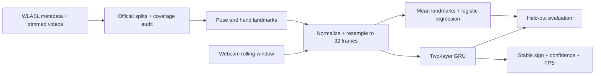

# Isolated ASL Recognition Toolkit

A developer-focused Python toolkit and CLI for isolated American Sign Language (ASL) word recognition: prepare datasets, extract hand/body landmarks, train baseline and GRU models, and evaluate predictions. This is an educational implementation of Project 3 from the supplied ML project guide.

**Locked project direction:** the open-source Python package and CLI are the primary deliverable. The existing website is the demonstration interface. The [agreed scope and release plan](docs/PROJECT_DIRECTION.md) distinguish existing functionality from the work required for a packaged release.

**Developer quick start: [Python API, installation, saved-video prediction, and JSON output](docs/PACKAGE_GUIDE.md).** Version 0.4.0 includes `SignRecognizer`, prediction/model-export commands, cache-quality auditing, improved missing-landmark handling, and the expanded reference baseline. The core needs NumPy; video, baseline-checkpoint, and training dependencies are optional. Install release archives from [GitHub Releases](https://github.com/veerendrakosuri/sign-language-recognition/releases); PyPI publication is not claimed.

**[Try the public SignLab web app](https://signlab-asl-veerendra.heartyspoon1024.chatgpt.site)** — upload a short video containing one ASL word. This is a research preview; browser-upload accuracy has not been measured.

**Status:** implementation, training/evaluation materials, and a browser research preview are provided. A local training run on a 71.9%-complete WLASL100 video collection has been evaluated; its [measured results and coverage limits](reports/wlasl100-expanded-run-2026-10-18/README.md) are below. The original checkpoint stays local, while the evaluated baseline's numeric weights are exported for the [web app](web/README.md). No full WLASL100 benchmark, browser-upload accuracy, or live-webcam accuracy is claimed. Google's downloaded detector models locate landmarks; they do not recognize ASL words.

**Start here: [complete step-by-step guide](docs/PROJECT_GUIDE.md).** It explains the concepts, every command, expected files, troubleshooting, and a three-week plan.

## What is included

- Official WLASL split manifest and missing-video coverage report.
- Python inference API and saved-video/landmark CLI prediction with ranked JSON results.
- Numeric JSON baseline export, explicit joblib trust, model hashes, and tracking diagnostics.
- MediaPipe Tasks extraction: 33 pose + 21 left-hand + 21 right-hand points.
- Shared normalization, missing-point masks, and 32-frame resampling.
- Observed-frame mean-landmark logistic regression baseline and two-layer GRU.
- Validation-based model selection, reproducible seeds, saved configurations.
- Top-1/top-5 accuracy, macro F1, per-class metrics, predictions, and confusion matrices.
- Local webcam demo with temporal smoothing, uncertain state, and FPS display.
- Browser upload app for one isolated ASL word, processed on the visitor's device.
- Automated tests, CI, a starter notebook, experiment templates, and report guidance.
- Cache-quality auditing and a token-free, manually gated PyPI publishing workflow.



## Windows quick start

Install 64-bit Python 3.11 or 3.12 and Git. In PowerShell:

```powershell
git clone https://github.com/veerendrakosuri/sign-language-recognition.git
cd sign-language-recognition
py -3.11 -m venv .venv
.\.venv\Scripts\python.exe -m pip install --upgrade pip
.\.venv\Scripts\python.exe -m pip install torch --index-url https://download.pytorch.org/whl/cpu
.\.venv\Scripts\python.exe -m pip install -r requirements.txt
.\.venv\Scripts\python.exe -m pytest -q
.\.venv\Scripts\python.exe -m signlang.cli download-models
```

Python 3.12 users: change `py -3.11` to `py -3.12`. Activation is optional: calling the virtual environment's Python directly avoids PowerShell activation-policy errors. On Linux/macOS use `python3.11 -m venv .venv` and `.venv/bin/python`.

Obtain **pre-trimmed WLASL clips** following [dataset instructions](docs/DATASET.md), then run:

```powershell
.\.venv\Scripts\python.exe -m signlang.cli manifest --metadata data/WLASL_v0.3.json --videos data/videos --classes 100
.\.venv\Scripts\python.exe -m signlang.cli extract
.\.venv\Scripts\python.exe -m signlang.cli audit --output runs/landmark-audit-v1.json
.\.venv\Scripts\python.exe -m signlang.cli baseline --output runs/baseline-v1
.\.venv\Scripts\python.exe -m signlang.cli train --output runs/gru-v1
.\.venv\Scripts\python.exe -m signlang.cli evaluate --kind baseline --checkpoint runs/baseline-v1/baseline.joblib --output runs/baseline-test-v1 --trust-checkpoint
.\.venv\Scripts\python.exe -m signlang.cli evaluate --kind gru --checkpoint runs/gru-v1/best.pt --output runs/gru-test-v1
.\.venv\Scripts\python.exe -m signlang.cli webcam --checkpoint runs/gru-v1/best.pt
.\.venv\Scripts\python.exe -m signlang.cli webcam --kind baseline --checkpoint runs/baseline-v1/baseline.joblib --trust-checkpoint
```

Use a fresh output directory for every experiment. Do not tune using test results. If starting with `--classes 10`, call the experiment **WLASL first-10 prototype**, not WLASL100.
The two webcam commands let you compare the trained GRU with the mean-landmark baseline; run one at a time. The baseline had higher accuracy on the available offline test clips, but neither model has measured live-camera accuracy.

## Results

| Experiment | Test coverage | Top-1 | Top-5 | Macro F1 | Live FPS |
|---|---|---|---|---|---|
| Expanded observed-frame logistic regression | 201/258 official test clips | 0.5323 | 0.7960 | 0.4916 | N/A |
| Previous observed-frame baseline (v0.3.0) | 100/258 official test clips | 0.3800 | 0.7300 | 0.2769 | N/A |
| Previous GRU (not retrained on expanded data) | 100/258 official test clips | 0.3000 | 0.6200 | 0.1993 | Not measured |

These are measured results on **available subsets**, not the complete WLASL100 benchmark. The expanded result covers 201 official test IDs and lacks test examples for 2 of 100 classes; its denominator differs from the older results, so the rows are not a controlled model-only comparison. The browser app samples video frames differently from the offline evaluator, so its real-world upload accuracy is unknown. The [expanded run report](reports/wlasl100-expanded-run-2026-10-18/README.md) records the denominator, missing classes, hashes, and exact IDs. Synthetic tests validate program behavior; their scores do not measure sign-language recognition. For fewer than five classes the reported top-k uses k = class count and is not informative.

The [expanded landmark audit](reports/wlasl100-expanded-run-2026-10-18/landmark_audit.json) found no malformed caches, but 438 of 1,466 clips had an assigned hand in fewer than half their frames. The previously trained GRU checkpoint and detector assets passed local inference/startup checks. A live camera trial and ASL-qualified review of clip labels are still needed.

## File map

```text
src/signlang/       data preparation, extraction, training, evaluation, webcam CLI
tests/             preprocessing, split/metric and end-to-end synthetic tests
docs/              full guide, dataset instructions, architecture, report/model card
notebooks/         dataset exploration starter notebook
reports/           editable experiment and live-test templates
data/              your videos, metadata, cached landmarks (ignored)
models/            downloaded MediaPipe assets (ignored)
runs/              checkpoints and experiment results (ignored)
web/               browser app, exported numeric baseline weights, tests
```

See [output file reference](docs/OUTPUTS.md) for every generated artifact.

Maintainers can follow the [PyPI trusted-publishing guide](docs/PUBLISHING.md). Account registration and the first public registry upload still require the repository owner.

## Scope and limitations

This is **isolated ASL word classification**, not full-sentence translation, fingerspelling recognition, or Indian Sign Language recognition. ASL and ISL are different languages. The model only predicts its trained vocabulary. A softmax threshold is a heuristic and can still accept unknown gestures confidently. A rolling webcam window has no learned sign-boundary detector. No face mesh is used, so facial grammar is absent. Actual accuracy and speed depend on data coverage, signer, camera, and hardware.

Raw videos, personal webcam recordings, the original Python checkpoints, and the original supplied guide are not published in this repository. The web app includes the evaluated baseline's numeric weights and does not upload visitor videos. Review the upstream dataset terms before use or redistribution. No commercial-use permission is implied for WLASL or derived artifacts.

## Sources

- [WLASL official repository, data access and citation](https://github.com/dxli94/WLASL)
- [MediaPipe Hand Landmarker Python](https://developers.google.com/edge/mediapipe/solutions/vision/hand_landmarker/python)
- [MediaPipe Pose Landmarker Python](https://developers.google.com/edge/mediapipe/solutions/vision/pose_landmarker/python)
- [PyTorch GRU documentation](https://docs.pytorch.org/docs/stable/generated/torch.nn.GRU.html)
- [scikit-learn logistic regression](https://scikit-learn.org/stable/modules/generated/sklearn.linear_model.LogisticRegression.html)
