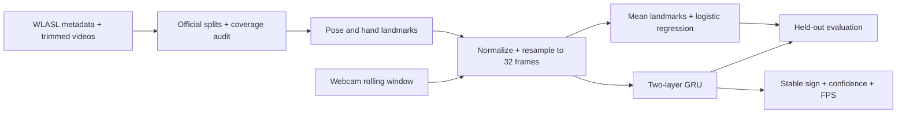

# Real-time sign language recognition

Recognize isolated American Sign Language (ASL) words using webcam video, MediaPipe hand/body landmarks, and a PyTorch GRU. This is an educational implementation of Project 3 from the supplied ML project guide.

**Status:** implementation and learning materials provided. No WLASL-trained checkpoint or real-world accuracy is claimed. You must obtain the videos, train, and evaluate before the webcam demo can recognize signs. Google's downloaded detector models locate landmarks; they do not recognize ASL words.

**Start here: [complete step-by-step guide](docs/PROJECT_GUIDE.md).** It explains the concepts, every command, expected files, troubleshooting, and a three-week plan.

## What is included

- Official WLASL split manifest and missing-video coverage report.
- MediaPipe Tasks extraction: 33 pose + 21 left-hand + 21 right-hand points.
- Shared normalization, missing-point masks, and 32-frame resampling.
- Mean-landmark logistic regression baseline and two-layer GRU.
- Validation-based model selection, reproducible seeds, saved configurations.
- Top-1/top-5 accuracy, macro F1, per-class metrics, predictions, and confusion matrices.
- Local webcam demo with temporal smoothing, uncertain state, and FPS display.
- Automated tests, CI, a starter notebook, experiment templates, and report guidance.



## Windows quick start

Install 64-bit Python 3.11 or 3.12 and Git. In PowerShell:

```powershell
git clone https://github.com/veerendrakosuri/sign-language-recognition.git
cd sign-language-recognition
py -3.11 -m venv .venv
.\.venv\Scripts\python.exe -m pip install --upgrade pip
.\.venv\Scripts\python.exe -m pip install torch --index-url https://download.pytorch.org/whl/cpu
.\.venv\Scripts\python.exe -m pip install -r requirements.txt
.\.venv\Scripts\python.exe -m pytest -q
.\.venv\Scripts\python.exe -m signlang.cli download-models
```

Python 3.12 users: change `py -3.11` to `py -3.12`. Activation is optional: calling the virtual environment's Python directly avoids PowerShell activation-policy errors. On Linux/macOS use `python3.11 -m venv .venv` and `.venv/bin/python`.

Obtain **pre-trimmed WLASL clips** following [dataset instructions](docs/DATASET.md), then run:

```powershell
.\.venv\Scripts\python.exe -m signlang.cli manifest --metadata data/WLASL_v0.3.json --videos data/videos --classes 100
.\.venv\Scripts\python.exe -m signlang.cli extract
.\.venv\Scripts\python.exe -m signlang.cli baseline --output runs/baseline-v1
.\.venv\Scripts\python.exe -m signlang.cli train --output runs/gru-v1
.\.venv\Scripts\python.exe -m signlang.cli evaluate --kind baseline --checkpoint runs/baseline-v1/baseline.joblib --output runs/baseline-test-v1
.\.venv\Scripts\python.exe -m signlang.cli evaluate --kind gru --checkpoint runs/gru-v1/best.pt --output runs/gru-test-v1
.\.venv\Scripts\python.exe -m signlang.cli webcam --checkpoint runs/gru-v1/best.pt
```

Use a fresh output directory for every experiment. Do not tune using test results. If starting with `--classes 10`, call the experiment **WLASL first-10 prototype**, not WLASL100.

## Results

| Experiment | Test coverage | Top-1 | Top-5 | Macro F1 | Live FPS |
|---|---|---|---|---|---|
| Logistic regression | Not evaluated | — | — | — | N/A |
| GRU | Not evaluated | — | — | — | Not measured |

Populate this table only from real evaluation output. Synthetic tests validate program behavior; their scores do not measure sign-language recognition. Keep identical evaluated IDs for model comparisons. For fewer than five classes the reported top-k uses k = class count and is not informative.

## File map

```text
src/signlang/       data preparation, extraction, training, evaluation, webcam CLI
tests/             preprocessing, split/metric and end-to-end synthetic tests
docs/              full guide, dataset instructions, architecture, report/model card
notebooks/         dataset exploration starter notebook
reports/           editable experiment and live-test templates
data/              your videos, metadata, cached landmarks (ignored)
models/            downloaded MediaPipe assets (ignored)
runs/              checkpoints and experiment results (ignored)
```

See [output file reference](docs/OUTPUTS.md) for every generated artifact.

## Scope and limitations

This is **isolated ASL word classification**, not full-sentence translation, fingerspelling recognition, or Indian Sign Language recognition. ASL and ISL are different languages. The model only predicts its trained vocabulary. A softmax threshold is a heuristic and can still accept unknown gestures confidently. A rolling webcam window has no learned sign-boundary detector. No face mesh is used, so facial grammar is absent. Actual accuracy and speed depend on data coverage, signer, camera, and hardware.

Raw videos, personal webcam recordings, model weights, and the original supplied guide are not published in this repository. Review the upstream dataset terms before use or redistribution. No commercial-use permission is implied for WLASL or derived artifacts.

## Sources

- [WLASL official repository, data access and citation](https://github.com/dxli94/WLASL)
- [MediaPipe Hand Landmarker Python](https://developers.google.com/edge/mediapipe/solutions/vision/hand_landmarker/python)
- [MediaPipe Pose Landmarker Python](https://developers.google.com/edge/mediapipe/solutions/vision/pose_landmarker/python)
- [PyTorch GRU documentation](https://docs.pytorch.org/docs/stable/generated/torch.nn.GRU.html)
- [scikit-learn logistic regression](https://scikit-learn.org/stable/modules/generated/sklearn.linear_model.LogisticRegression.html)

